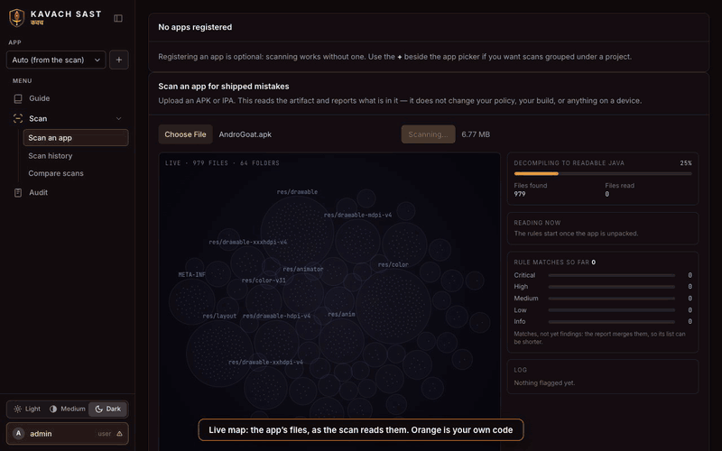
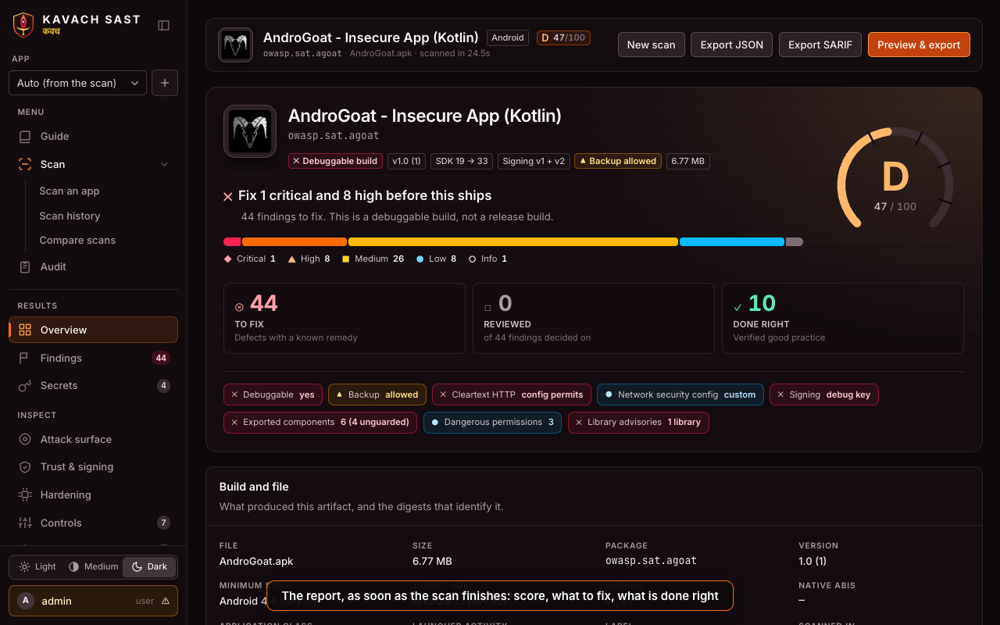
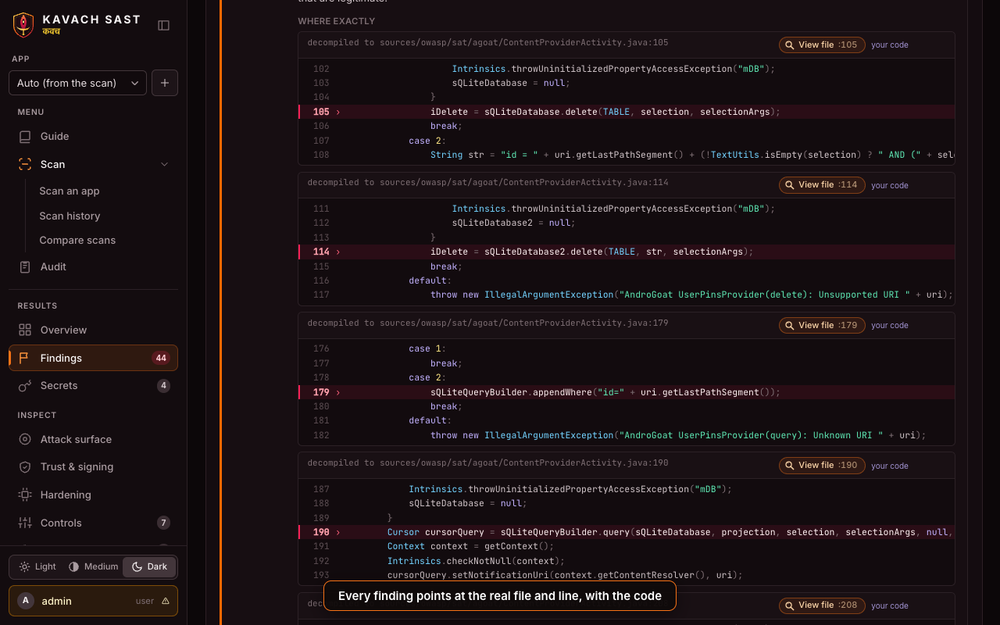
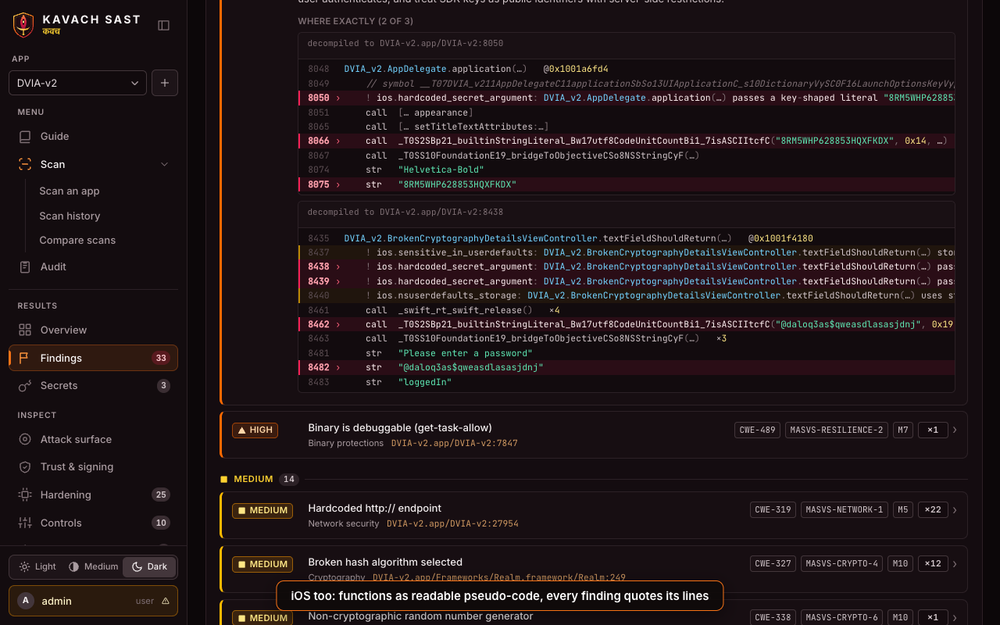
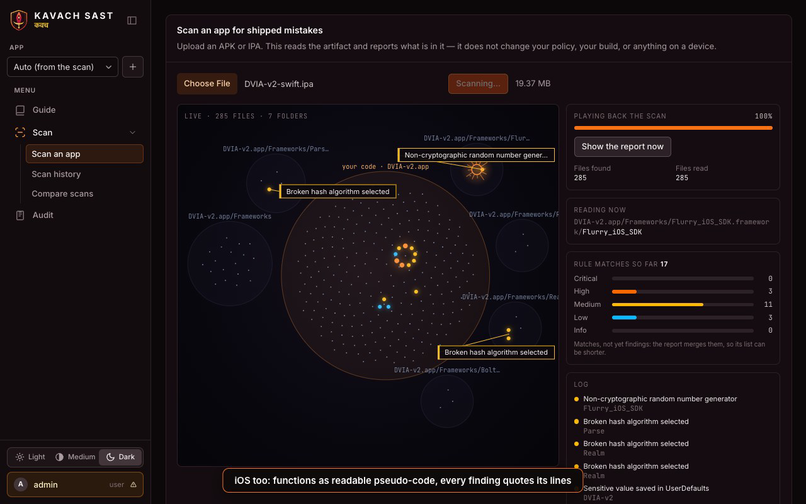
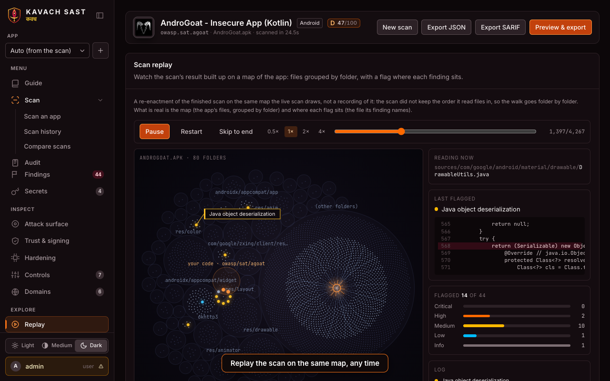

<div align="center">


# KAVACH SAST &nbsp;<sup>कवच</sup>

### Know what's wrong with your mobile app, before anyone else does.

Drop in an **APK** or **IPA**. Watch it get read. Get a report you can act on.<br>
Self-hosted · nothing leaves your machine · your app is never run


[](LICENSE)

<br>



<sub>A live scan. Every dot is a file, orange is your own code, a flag is a finding. &nbsp;<a href="docs/media/kavach-sast-demo.mp4">Watch the 67-second demo</a></sub>

</div>

<br>

## ⚡ Run it in a minute

Download `kavach-sast-0.1.0.zip` from the [latest release](https://github.com/harshbhanushali/kavach-sast/releases/latest) and unpack it:

```bash
unzip kavach-sast-0.1.0.zip && cd kavach-sast-0.1.0
```

### 🐳 With Docker

```bash
docker compose up -d --build
```

### 🐧 On Linux, without Docker

One script installs everything: Node.js, a JDK, apktool, jadx, apksigner, qpdf and Chromium, then builds
the app and starts it as a service that comes back after a reboot.

```bash
sudo ./scripts/install-linux.sh
```

- Works on Debian, Ubuntu, Fedora and RHEL families, on x86_64 and arm64. It asks before changing anything
  and keeps its own tools under `/opt/kavach-tools`, so your system's Node and Java are untouched.
- Unattended: `sudo ./scripts/install-linux.sh --yes --accept-android-sdk-license --admin-password 'choose-one'`
  (apksigner comes from Google's Android SDK, so its licence has to be accepted).
- Other options: `--port 9000`, `--no-service`, `--help` lists the rest.
- Upgrade: pull the new version and run it again. Your data and settings stay.
  Logs: `journalctl -u kavach-sast -f`. Remove: `sudo ./scripts/install-linux.sh --uninstall`.

### 🚀 Then

Open **http://localhost:8788**, sign in with `admin` / `kavach`, and drop an app on it.

> 🔐 `kavach` is a published default. The console nags you until you change it, and you should
> before anyone else can reach the server (or pass `--admin-password` to the script).

<br>

## 🎯 What you get

<table>
<tr>
<td width="50%"><b>🗺️ A live map of the scan</b><br>Files appear as they are read, flags light up where a rule matches. Replay any finished scan on the same map.</td>
<td width="50%"><b>🔎 Findings with receipts</b><br>Each one names the real file and line and quotes the code, so you can check it in seconds.</td>
</tr>
<tr>
<td><b>📱 Android and iOS</b><br>Decompiled Java on one side, machine code read back as readable pseudo-code on the other.</td>
<td><b>📄 A report you can hand over</b><br>A score, what to fix first, one clear list. PDF (even password-locked), JSON and SARIF for CI.</td>
</tr>
<tr>
<td><b>✅ Triage that sticks</b><br>Mark findings confirmed, false positive or accepted risk. Decisions carry to the next build.</td>
<td><b>📈 Track progress</b><br>Compare two builds of the same app and see what got fixed and what is new.</td>
</tr>
</table>

<br>

## 🧾 A finding, up close

```text
● CRITICAL   AWS secret access key alongside an access key ID
  sources/owasp/sat/agoat/CloudServicesActivity.java:20
  CWE-798 · MASVS-STORAGE-1 · OWASP M1
  → shows the exact lines, why it matters, how to exploit it, and how to fix it
```

<table>
<tr>
<td width="33%"><br><sub><b>The report</b>: score, what to fix, what is done right</sub></td>
<td width="33%"><br><sub><b>Android</b>: decompiled code, evidence line marked</sub></td>
<td width="33%"><br><sub><b>iOS</b>: the function, readable, evidence marked</sub></td>
</tr>
</table>

<details>
<summary>More screenshots</summary>
<br>
 
</details>

<br>

## 🛡️ What it looks for

Hardcoded keys and secrets · weak or misused cryptography · insecure storage · cleartext traffic and
broken certificate checks · exported components and risky permissions · debuggable and backup-able
builds · risky WebViews · SQL built from input · signing and hardening gaps · vulnerable libraries ·
privacy trackers · every endpoint the app talks to.

Findings carry CWE, OWASP MASVS and OWASP Mobile Top 10 references. Over 180 code rules, plus
manifest, signing and binary checks.

<br>

## 📚 Go deeper

| Read | For |
|---|---|
| [**Guide**](docs/GUIDE.md) | Using it, what a scan reports, triage, the API, SARIF for CI, configuration |
| [**Deployment**](DEPLOYMENT.md) | HTTPS, limits, backups, upgrades, security model, go-live checklist |
| [**Contributing**](CONTRIBUTING.md) | Run the tests, add a rule |
| [**Security**](SECURITY.md) | Report a vulnerability privately |
| [**Changelog**](CHANGELOG.md) | What's in each release |

<br>

<div align="center">

Built by [Harsh Bhanushali](https://github.com/harshbhanushali) · [Apache-2.0](LICENSE) · [Third-party credits](NOTICE)

</div>
